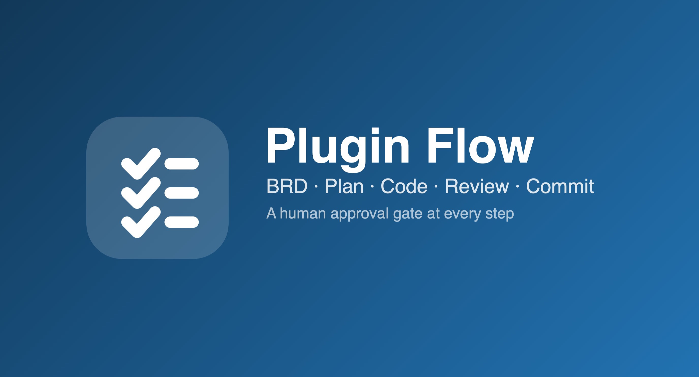

# Zealagent Plugin Flow

[English](https://github.com/zealagent/plugin-flow/blob/main/README.md) | [Tiếng Việt](https://github.com/zealagent/plugin-flow/blob/main/README_VI.md) | [中文](https://github.com/zealagent/plugin-flow/blob/main/README_CN.md)



A PM/Reviewer build workflow with a human approval gate at every step, for the agent platforms you already use: BRD, Plan, delegated coding, Review, Commit.

- **One protocol** — the same phases, gates and rules on every platform, written once in a private core.
- **One plugin per platform** — Claude Code and DeepSeek Harness, each self-contained and idiomatic to its host.
- **Any coder** — planning and review can run in your session or on a cheaper model; the coder can be any provider, model or CLI you configure.

Plugin Flow never skips a gate, never writes code itself, and never stores an API key. It is a workflow, not a model.

> **Note**
> Plugin Flow runs a PM/Reviewer workflow with a human approval gate at every step: BRD, Plan, delegated coding, Review, Commit. It never skips a gate and never stores an API key; it names the environment variable that holds one.
>
> It is not a coding model or an agent runtime. The coder is whatever model or CLI you configure in `.zla-flow/coder.json`.

## Platforms

| Platform | Package | Documentation |
| --- | --- | --- |
| Claude Code | `@zealagent/plugin-flow-claude` (plugin `zla-flow`) | [README](https://github.com/zealagent/plugin-flow/blob/main/packages/claude/README.md) |
| DeepSeek Harness | `@zealagent/plugin-flow-deepseek-harness` | [README](https://github.com/zealagent/plugin-flow/blob/main/packages/deepseek-harness/README.md) |

Each platform plugin is self-contained and installs on its own. Both are run as `/zla-flow`.

## Installation

```text
Claude Code:      /plugin marketplace add zealagent/plugin-flow
                  /plugin install zla-flow@zealagent
DeepSeek Harness: enable @zealagent/plugin-flow-deepseek-harness in Settings → Plugins
```

## License

MIT © Zealagent
