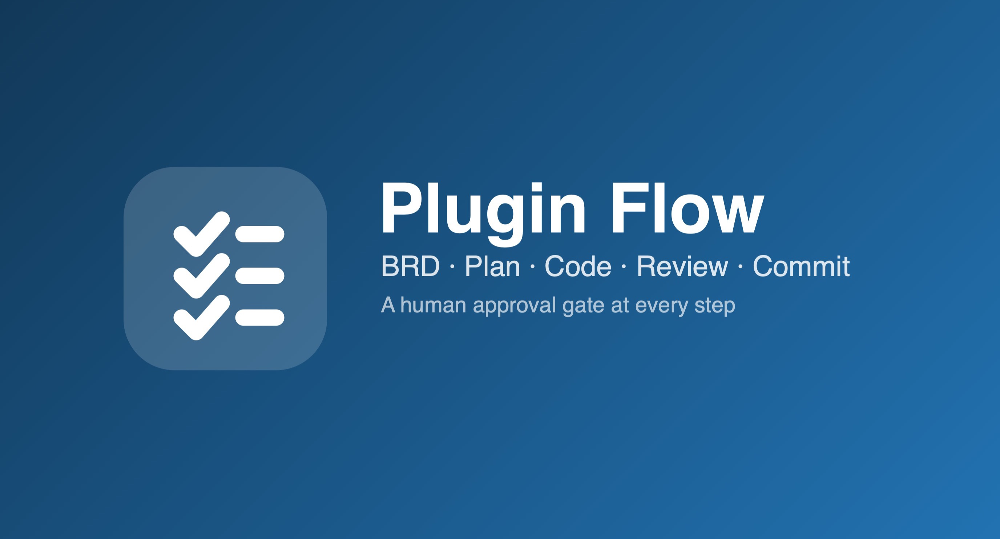

# Zealagent Plugin Flow

[English](https://github.com/zealagent/plugin-flow/blob/main/README.md) | [Tiếng Việt](https://github.com/zealagent/plugin-flow/blob/main/README_VI.md) | [中文](https://github.com/zealagent/plugin-flow/blob/main/README_CN.md)



Quy trình xây dựng PM/Reviewer với cổng phê duyệt của con người ở mọi bước, dành cho các nền tảng agent bạn đang dùng: BRD, Plan, giao việc viết code, Review, Commit.

- **Một giao thức** — cùng các phase, cổng và quy tắc trên mọi nền tảng, viết một lần trong một core riêng.
- **Mỗi nền tảng một plugin** — Claude Code và DeepSeek Harness, mỗi plugin tự chứa đủ và đúng phong cách của nền tảng đó.
- **Coder tùy chọn** — lập kế hoạch và review có thể chạy trong session của bạn hoặc trên một model rẻ hơn; coder có thể là bất kỳ nhà cung cấp, model hay CLI nào bạn cấu hình.

Plugin Flow không bao giờ bỏ qua cổng, không tự viết code và không lưu API key. Nó là một quy trình làm việc, không phải một model.

> **Note**
> Plugin Flow chạy quy trình PM/Reviewer với cổng phê duyệt của con người ở mọi bước: BRD, Plan, giao việc viết code, Review, Commit. Nó không bao giờ bỏ qua cổng và không lưu API key; nó chỉ ghi tên biến môi trường chứa key.
>
> Nó không phải là model viết code hay môi trường chạy agent. Coder là model hoặc CLI bạn cấu hình trong `.zla-flow/coder.json`.

## Platforms

| Platform | Package | Documentation |
| --- | --- | --- |
| Claude Code | `@zealagent/plugin-flow-claude` (plugin `zla-flow`) | [README](https://github.com/zealagent/plugin-flow/blob/main/packages/claude/README.md) |
| DeepSeek Harness | `@zealagent/plugin-flow-deepseek-harness` | [README](https://github.com/zealagent/plugin-flow/blob/main/packages/deepseek-harness/README.md) |

Mỗi plugin nền tảng tự chứa đủ và được cài riêng. Cả hai đều chạy bằng `/zla-flow`.

## Installation

```text
Claude Code:      /plugin marketplace add zealagent/plugin-flow
                  /plugin install zla-flow@zealagent
DeepSeek Harness: enable @zealagent/plugin-flow-deepseek-harness in Settings → Plugins
```

## License

MIT © Zealagent
