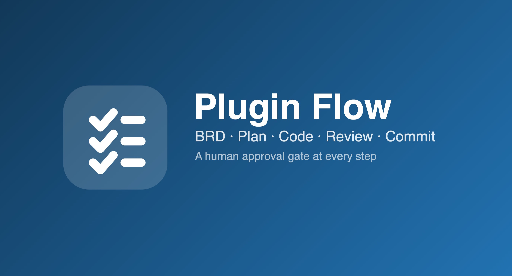

# zla-flow for Claude Code

[English](https://github.com/zealagent/plugin-flow/blob/main/packages/claude/README.md) | [Tiếng Việt](https://github.com/zealagent/plugin-flow/blob/main/packages/claude/README_VI.md) | [中文](https://github.com/zealagent/plugin-flow/blob/main/packages/claude/README_CN.md)



A PM/Reviewer build workflow with a human approval gate at every step, as a Claude Code plugin: the `/zla-flow` skill. Plan and Review can run in the current session or on a cheaper Claude model.

The coder can be a subagent of this session, a Harness MCP server, any Anthropic-compatible endpoint, or any CLI. Nothing is pinned to a vendor.

```text
Phase 0 Adopt ─▶ GATE 0 ─▶ Phase 1 BRD ─▶ GATE 1 ─▶ Phase 2 Plan ─▶ GATE 2
       ─▶ Phase 3 Execute ─▶ Phase 4 Review ─▶ GATE 3 ─▶ Phase 5 Commit
```

> **Note**
> Plugin Flow runs a PM/Reviewer workflow with a human approval gate at every step: BRD, Plan, delegated coding, Review, Commit. It never skips a gate and never stores an API key; it names the environment variable that holds one.
>
> It is not a coding model or an agent runtime. The coder is whatever model or CLI you configure in `.zla-flow/coder.json`.

## Install

From the marketplace in this repository:

```text
/plugin marketplace add zealagent/plugin-flow
/plugin install zla-flow@zealagent
```

Or load it straight from a checkout for one session:

```bash
claude --plugin-dir packages/claude
```

## Use it

```text
/zla-flow Add pagination to GET /orders, 100 rows max, with unit tests.
```

Phase 1 writes the BRD and stops at GATE 1. Answer each gate in the conversation:

```text
approve BRD
approve plan
approve review, commit
reject <reason>
```

| Flag | Argument | Default | Description |
| --- | --- | --- | --- |
| `--planner` | `<use>` | `roles.planner.use`, else `self` | Who writes the plan. |
| `--reviewer` | `<use>` | `roles.reviewer.use`, else `self` | Who reviews. |
| `--coder` | `<profile>` | `active` in `coder.json` | Coder profile for this run. |
| `--model` | `<alias>` | the profile's `model` | Model alias inside that profile. |
| `--adopt` | `[path]` | — | Take over a project that already has plans, a BRD or code. |
| `--resume` | `<task-id>` | — | Continue an interrupted run from its state file. |
| `--from` | `<brd\|plan\|execute\|review>` | — | Start at that phase when the earlier artifacts exist. |

`--from` never skips an approval: `plan` needs GATE 1, `execute` needs GATE 1 and 2, and `review` also needs executed parts. A gate that isn't recorded in the state file `.zla-flow/state/<task-id>.json` is presented again, and the run stops there. `--resume` counts a part left `running` as failed and continues at the first part that isn't done.

## Phases and gates

| Phase | What happens | Gate |
| --- | --- | --- |
| 0. Adopt | Scan existing plans, BRD and code; label every part with evidence. Read-only outside `.zla-flow/`. | ⏸ GATE 0 |
| 1. BRD | Goals, scope, requirements, acceptance criteria, risks; names the planner, reviewer and coder. | ⏸ GATE 1 |
| 2. Plan | Numbered plan files under `.zla-flow/plans/<task-id>/`, each small enough for one coder run. | ⏸ GATE 2 |
| 3. Execute | One part at a time, tests after each; no commits. | ⏸ PART FAILED, only on a failure |
| 4. Review | The real diff, one pass per part, every finding with file and line. | ⏸ GATE 3 |
| 5. Commit | One commit of this run's files. Never a push. | after GATE 3 |

A gate is approved only by a clear approval for that gate. An ambiguous "ok" is asked about again. At GATE 3 answer `approve`, `fix` + instructions, `discard` or `stop`. At PART FAILED answer `retry` (optionally naming another profile or alias), `fix`, `discard` or `stop`. Nothing is reverted unless you answer `discard`.

## Roles

Plan and Review resolve from `--planner` / `--reviewer`, then `roles.<role>.use` in `.zla-flow/coder.json`, then `self`.

| Value | Meaning |
| --- | --- |
| `self` | This session does the work. Default, most expensive. |
| `subagent` | A read-only subagent on the session's default subagent model. |
| `claude:<model>` | A read-only subagent on that model alias, e.g. `claude:haiku` or `claude:sonnet`. |
| `coder:<profile>[/<alias>]` | The Harness `run_role` tool on that `coder.json` profile, read-only. Needs a Harness. |

A delegated planner returns the plan text and this session writes the files. A role whose lane is missing is reported at GATE 1, and `self` is used only if you agree.

## Coder configuration

`coder.json` is optional. To configure a coder, copy [`config/coder.example.json`](https://github.com/zealagent/plugin-flow/blob/main/packages/claude/config/coder.example.json) to `.zla-flow/coder.json` in your project and fill in the endpoint, model and the **name** of the environment variable that holds the key. The file is the same for every platform of zla-flow. With no `coder.json` at all, the coder is a file-editing subagent of the current session.

| Situation | Lane |
| --- | --- |
| A Harness MCP server is connected | The Harness runs every part, for any profile. |
| No `coder.json` and no `--coder`/`--model` | A file-editing subagent of this session. |
| Profile `protocol: "command"` | The CLI runs through Bash with `{model}`, `{prompt_file}`, `{workdir}`, `{branch}`. |
| Profile `protocol: "anthropic"` | Headless `claude -p` against `base_url`, with the key passed from `api_key_env`. |
| Profile `protocol: "openai"` | Needs a Harness; without one the run stops and says so. |

The workflow never switches lanes, profiles or models on its own after a failure.

### Adding a coder

No plugin or skill change is needed: edit `.zla-flow/coder.json` only.

A new plan tier of an existing provider is a profile that `extends` the existing one and overrides only what differs:

```json
"provider-pro": { "extends": "provider-lite", "api_key_env": "PROVIDER_PRO_API_KEY" }
```

A new model under an existing provider is an alias in that profile's `models` map, used as `/zla-flow --model <alias> <task>`. A new provider is a profile with a `protocol`:

| Protocol | Use when | How zla-flow runs it without a Harness |
| --- | --- | --- |
| `anthropic` | The endpoint speaks the Anthropic messages API. | Headless `claude -p` with `ANTHROPIC_BASE_URL`, `ANTHROPIC_AUTH_TOKEN` (from `api_key_env`) and `ANTHROPIC_MODEL`. |
| `openai` | An OpenAI-compatible chat endpoint. | It doesn't: this lane needs a Harness that runs its own tool loop. |
| `command` | Any other CLI agent or your own script. | Runs `command` with `{model}`, `{prompt_file}`, `{workdir}`, `{branch}` substituted and env from `env`. |

### Harness contract

A Harness is an MCP server that runs coder jobs for any profile. When one is connected, zla-flow uses it first. An adapter must satisfy:

- `submit_task(plan_file, coder, model_alias, context_summary)` runs one plan part and returns a `job_id`; work happens on branch `<branch_prefix><task-id>`. It refuses a new job while another runs (`limits.max_concurrent_jobs`, default 1) and refuses prompts above `limits.job_prompt_max_chars`.
- It enforces `limits.job_memory_limit_mb` and `timeout_seconds` on the coder process, kills the job on breach and reports `failed` with reason `memory_limit` or a timeout.
- `get_status(job_id)` returns `queued | running | done | failed` plus a short summary.
- `get_result(job_id)` returns changed files, the part's diff, the Harness's own test results (not the coder's claims), and a log file path.
- `run_role(role, coder, model_alias, prompt_file)` runs a read-only planner or reviewer prompt on any configured coder and returns its text. It must not allow file writes or git writes.
- The Harness never commits, never pushes, and never reads or returns API keys.

For adopted work, `submit_task` receives in `context_summary` the status of the part (`not_started` or `partial`), what already exists for a `partial` part, and the project's detected test command. The Harness runs only that part's tests plus the existing test command, and does not touch files outside the part's declared scope.

## Package layout

```text
packages/claude/
├── .claude-plugin/plugin.json   plugin manifest (icon.png beside it)
├── skills/zla-flow/SKILL.md     the workflow protocol (/zla-flow, generated)
├── config/coder.example.json    starter project configuration (generated)
├── tests/plugin.test.mjs        offline checks (pnpm test), not shipped
└── README.md                    this document
```

`SKILL.md` and `config/coder.example.json` are generated from [`packages/core`](https://github.com/zealagent/plugin-flow/blob/main/packages/core/README.md): edit the protocol and the Claude fragments there and run `pnpm sync` at the repository root. `pnpm check` confirms the generated files are current, the manifest and skill are well formed, and the root marketplace points here.

## Limitations

- Gates hold because the model follows the protocol. No hook enforces them, so read the gate lines as the contract and reject explicitly.
- `coder.json` is a convention, not a validated schema. A typo shows up as a coder failure, not as a validation error.
- The `anthropic` lane needs the `claude` CLI on `PATH`. Runtime memory limits are only enforced when a Harness runs the coder.
- Only Phase 5 commits, and the workflow never pushes.

## License

MIT © Zealagent. Written by nqhed - Huy Ed. Nguyen.
