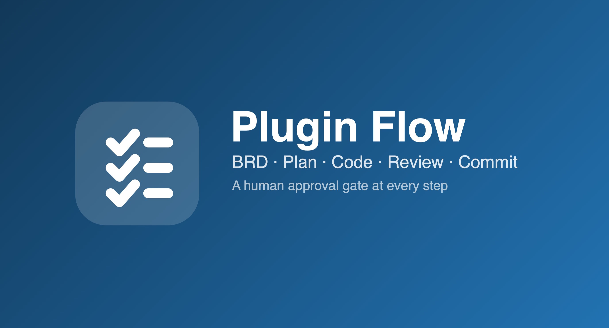

# zla-flow for DeepSeek Harness

[English](https://github.com/zealagent/plugin-flow/blob/main/packages/deepseek-harness/README.md) | [Tiếng Việt](https://github.com/zealagent/plugin-flow/blob/main/packages/deepseek-harness/README_VI.md) | [中文](https://github.com/zealagent/plugin-flow/blob/main/packages/deepseek-harness/README_CN.md)



A PM/Reviewer build workflow with a human approval gate at every step, brought into DSH as a left-sidebar page plus a `/zla-flow` command. Plan and Review can run in the current session or be delegated to a cheaper or different model; the coder can be any provider, any model, or any CLI this profile can reach. Nothing is pinned to a vendor.

```text
Phase 0 Adopt ─▶ GATE 0 ─▶ Phase 1 BRD ─▶ GATE 1 ─▶ Phase 2 Plan ─▶ GATE 2
       ─▶ Phase 3 Execute ─▶ Phase 4 Review ─▶ GATE 3 ─▶ Phase 5 Commit
```

> **Note**
> Plugin Flow runs a PM/Reviewer workflow with a human approval gate at every step: BRD, Plan, delegated coding, Review, Commit. It never skips a gate and never stores an API key; it names the environment variable that holds one.
>
> It is not a coding model or an agent runtime. The coder is whatever model or CLI you configure in `.zla-flow/coder.json`.

## Install

Enable the `@zealagent/plugin-flow-deepseek-harness` bundle in Settings → Plugins, then refresh the page. The `/zla-flow` command and the sidebar entry appear after that.

## What it adds

- **A left-sidebar entry** named `zla-flow`, opening a full page in the main
  column.
- **The page**: a task box with optional coder profile and model alias, a
  button that seeds the command into a new session, a copyable command line, a
  copyable `coder.json` template, and a reference for phases, gates, roles,
  flags, limits and file layout.
- **The `/zla-flow` command**: expands the full protocol into the conversation
  and starts one turn, so every later gate is an ordinary message you answer.

## Where it appears

| Surface | What it is |
|---|---|
| Sidebar | `zla-flow` icon, after Plugins and Schedules. Clicking it opens the page. |
| Main column | The `zla-flow` page, keyed `zla-flow`: launch controls first, reference below. |
| Composer | `/zla-flow [flags] <task>`, in any session. |

## Use it

1. Click `zla-flow` in the left sidebar.
2. Type the task, for example `Add pagination to GET /orders, 100 rows max,
   with unit tests.`
3. Optionally set a coder profile and model alias for this run only.
4. Press **Start in a new session**. A new session opens with
   `/zla-flow <your flags> <your task>` already in the composer.
5. Press Enter there. Phase 1 (BRD) runs and stops at GATE 1.
6. Answer each gate in the conversation:

```text
approve BRD
approve plan
approve review, commit
reject <reason>
```

Typing the command directly is equivalent:
`/zla-flow --coder default --model fast Add pagination to GET /orders`.

## Phases and gates

| Phase | What happens | Gate |
|---|---|---|
| 0. Adopt | Scan existing plans, BRD and code; label every part with evidence. Read-only outside `.zla-flow/`. | ⏸ GATE 0 |
| 1. BRD | Goals, scope, out of scope, requirements, acceptance criteria, risks. | ⏸ GATE 1 |
| 2. Plan | Numbered plan files, each small enough for one coder run. | ⏸ GATE 2 |
| 3. Execute | One part at a time, in index order; stop at the first failure. No commits. | ⏸ PART FAILED, only on a failure |
| 4. Review | Read the real diff, one pass per part, every finding with file and line. | ⏸ GATE 3 |
| 5. Commit | One `git commit` with a clear message; report the hash. Never a push. | after GATE 3 |

A gate is approved only by a clear approval for **that** gate. An ambiguous
"ok" or "go on" is asked about again rather than guessed. A reject stops the
run at that phase until you give new direction.

Phase 3 runs straight into Phase 4 in the same turn; every other phase is its
own turn. Before the first part, Phase 3 checks for a clean tree, switches to
`<branch_prefix><task-id>` when a prefix is set, and resolves the coder. The
test command runs after every part, and a failing test stops the run.

### Answering GATE 3

| Answer | What happens |
|---|---|
| `approve` | Phase 5 commits only the files this run changed. |
| `fix` + instructions | The coder's changes stay. New `NN-fix-<slug>.md` units are written and shown at GATE 2; once approved, only they are executed and reviewed. |
| `discard` | Reverts exactly the files listed in the state file, shows what was reverted, and stops. |
| `stop` / `reject` | Leaves the working tree untouched and summarizes what is uncommitted. |

Nothing is reverted, reset or stashed unless you answer `discard`.

### Answering PART FAILED

When a coder part fails, a test fails or a limit is breached, Phase 3 marks the
part failed, skips Phase 4 and stops at `⏸ PART FAILED`.

| Answer | What happens |
|---|---|
| `retry` [profile or alias] | Runs the failed part once more, with the same coder or the one you name, then continues with the remaining parts. |
| `fix` + instructions | Writes an `NN-fix-<slug>.md` unit and shows it at GATE 2; once approved, it and the remaining parts run, then Phase 4. |
| `discard` | Same as at GATE 3. |
| `stop` | Same as at GATE 3; a later `--resume` continues at the failed part. |

## Roles and cost control

Plan and Review are the expensive steps. Each role resolves from the flag, then
`roles.<role>.use` in `coder.json`, then `self`.

| Value | Meaning |
|---|---|
| `self` | This session does the work. Default, most expensive. |
| `subagent` | A read-only subagent on the profile's default model. |
| `subagent:<provider>/<model>` | A read-only subagent on an explicit provider and model, for example `subagent:openai/gpt-5.1` or `subagent:deepseek/deepseek-chat`. Any provider the profile has works. |
| `coder:<profile>[/<alias>]` | A read-only subagent on the provider and model of a `coder.json` profile, optionally with an alias. Only `anthropic` or `openai` profiles: a `command` profile edits files, so it cannot hold a role. |

A delegated role is read-only: it may not edit files, run git writes, or
commit. The planner and reviewer are named at GATE 1, and the reviewer again at
GATE 2, so you can change them before anything is spent.

## Coder mechanisms

Phase 3 hands one plan part to a coder and waits for it. The workflow uses the
first mechanism the profile actually provides, and stops with a clear message
when none exists:

1. **A subagent that edits files**, started with the coder profile's provider
   and model. This is the default lane in DSH.
2. **An MCP coder server**, when one is connected.
3. **A CLI coder**, from the profile's `protocol: "command"`.

It never substitutes one mechanism for another on its own after a failure: it
reports the failure, names the alternatives, and waits.

## Coder configuration

`coder.json` is optional. Without it, and without `--coder` or `--model`, the
coder is the session default: a file-editing subagent on this session's default
model, else a connected MCP coder. A CLI coder always needs a profile.

A coder that cannot be resolved (a missing profile or alias, a broken
`extends` chain) never blocks the BRD or the Plan: GATE 1 and GATE 2 show it as
"unresolved" with the reason, so you can fix it in time. Only Phase 3 stops on
it.

Create `.zla-flow/coder.json` in the project. The page's **Copy coder.json
template** button copies a starter file; the same file ships as
[`config/coder.example.json`](https://github.com/zealagent/plugin-flow/blob/main/packages/deepseek-harness/config/coder.example.json). It is a convention the
workflow reads, not a file DSH validates.

```jsonc
{
  "version": 6,
  "active": "default",            // default coder profile
  "fallback": [],                 // a menu, never an automatic switch
  "coders": {
    "default": {
      "protocol": "openai",       // anthropic | openai | command
      "base_url": "https://…",
      "api_key_env": "CODER_API_KEY",  // the NAME of an env var, never the key
      "model": "default",         // default alias
      "models": { "default": "…" },    // short alias → real model id
      "temperature": 0.2,
      "max_tokens": 8192,
      "timeout_seconds": 900
    }
  }
}
```

### Transport lanes

| Protocol | Use it when | Fields that matter |
|---|---|---|
| `anthropic` | The provider speaks the Anthropic messages API, directly or through a proxy. | `base_url`, `api_key_env`, `model`, `models` |
| `openai` | The provider speaks the OpenAI chat API: hosted APIs, gateways, vLLM, Ollama, LM Studio. | `base_url`, `api_key_env`, `model`, `models`, `temperature`, `max_tokens` |
| `command` | Any CLI on the machine: a vendor CLI, an agent CLI, or your own script. | `command`, `env`, `model`, `models`, `timeout_seconds` |

A `command` profile's placeholders are `{model}`, `{prompt_file}`, `{workdir}`
and `{branch}`. The command must edit files in `{workdir}` and exit 0 on success.

The command runs from the project root with the profile's `env`. A prompt file
is written under `.zla-flow/state/`, and `timeout_seconds` caps the run time.

### Profile inheritance

A profile may `extends` another and override only what differs, so two plans of
one provider share the endpoint and differ only in the key or the model. The run
merges the chain field by field, child over parent; the `models` maps merge key
by key. A cycle or a missing parent stops the run.

### Keys

Only environment variable **names** belong in the file. The workflow never
asks for a key, never prints one, and never puts one in a plan or a commit.
Set the variable in the environment that starts DSH.

## `coder.json` reference

| Field | Meaning |
|---|---|
| `version` | Format version of this file. |
| `active` | Default profile for `--coder`-less runs. |
| `fallback` | Profiles offered when the active one fails. Never used silently. |
| `coders.<name>` | One profile: `protocol`, `base_url`, `api_key_env`, `model`, `models`, `timeout_seconds`, optional `extends`, `temperature`, `max_tokens`, `command`, `env`. |
| `workspace.branch_prefix` | Prefix for a coder's branch, when the mechanism uses one. |
| `workspace.test_command` | The project's real test command, discovered or stated. |
| `roles.planner.use` | Who writes the plan. |
| `roles.reviewer.use` | Who reviews. |
| `roles.reviewer.verify_high_severity` | When delegated, re-open every high-severity finding in this session. Default `true`. |
| `limits` | Size and runtime budgets, below. |
| `adopt` | Search paths and context files for Phase 0. |

## Size and runtime limits

| Field | Default | What it bounds |
|---|---|---|
| `plan_max_lines` | 120 | Lines per plan file. |
| `plan_max_steps` | 8 | Steps per plan file. |
| `plan_max_files_touched` | 6 | Files a plan part may touch. |
| `review_max_diff_lines` | 600 | Diff lines per review pass. |
| `max_concurrent_jobs` | 1 | Coder jobs running at once. |
| `job_prompt_max_chars` | 24000 | Characters handed to one coder job. |
| `job_memory_limit_mb` | 4096 | Memory budget a coder job assumes. |

The workflow splits plan files to stay inside these. Real enforcement of memory
and concurrency belongs to the host that runs the coder, not to this page.

A plan file that exceeds a limit is split into `NN-<slug>-01.md`,
`NN-<slug>-02.md` and so on, along module or layer boundaries, never in the
middle of a step, and every part is listed in the index.

## Where things live

| Path | Purpose |
|---|---|
| `.zla-flow/coder.json` | Profiles, roles, limits, adoption paths. |
| `.zla-flow/plans/<task-id>/` | `00-index.md` plus one file per unit of work. |
| `.zla-flow/state/<task-id>.json` | Progress of the current run, so `--resume` can continue it. |

Nothing of yours is edited, moved, renamed or deleted by the workflow; derived
files stay under `.zla-flow/`.

`<task-id>` is `YYYYMMDD-<slug>`, derived once from the task and stated in the
first reply. The state file has a fixed shape:

```json
{
  "task_id": "20261118-orders-pagination",
  "task": "…",
  "phase": 3,
  "approved_gates": [1, 2],
  "planner": "self",
  "reviewer": "subagent",
  "coder": { "profile": "default", "alias": "default", "model": "…", "mechanism": "subagent" },
  "branch": "task/20261118-orders-pagination",
  "parts": [{ "file": "01-api.md", "status": "done", "changed_files": ["src/orders.ts"], "error": null }],
  "updated_at": "…"
}
```

A gate is listed in `approved_gates` only after you approved it in the
conversation; files existing on disk never count as approval.

## Adopting an existing project

`--adopt [path]` starts at Phase 0. The run maps what already exists instead of
redoing it:

1. **Discover** the plans, BRDs, design docs and code that exist for the task,
   plus the project's guidance and build/test configuration, git status, branch
   and recent history.
2. **Import without modifying**: derived artifacts go under `.zla-flow/`, keeping
   your numbering and naming each original as its source.
3. **Assess with evidence**, one label per part:

| Label | Meaning |
|---|---|
| `done` | Done, with evidence in the repository. |
| `partial` | Partly done; the report says what is missing. |
| `not_started` | Not started. |
| `conflict` | The plan no longer matches the code; your decision is required. |
| `unclear` | Not enough information to decide; your decision is required. |

4. **Check the BRD**: summarize it and list gaps, or offer to write a short one.
5. **Report and stop at GATE 0.**

Checkboxes are not accepted as proof. Adoption never approves a BRD, a plan or a
review: those gates stay closed unless you say otherwise at GATE 0, naming which
ones. Resumed execution only runs `not_started` and `partial` parts, and for a
`partial` part the coder is told exactly what exists and what remains.

When `adopt.require_clean_tree` is true (the default) and the tree has unrelated
uncommitted changes, the run reports them and stops before executing.

## Flags

| Flag | Meaning |
|---|---|
| `--planner <use>` | Who writes the plan. |
| `--reviewer <use>` | Who reviews. |
| `--coder <profile>` | Coder profile for this run. |
| `--model <alias>` | Model alias inside that profile. |
| `--adopt [path]` | Take over a project that already has plans, a BRD or code. |
| `--resume <task-id>` | Continue an interrupted run from its state file. |
| `--from <brd\|plan\|execute\|review>` | Start at that phase when the earlier artifacts exist. |

`--from` never skips an approval: `plan` needs GATE 1, `execute` needs GATE 1
and 2, and `review` also needs executed parts. A gate that isn't recorded in
this task's state file is presented again, and the run stops there. `--resume`
checks the state file against the repository, counts a part left `running` as
failed, and continues at the first part that isn't done.

## Troubleshooting

| Symptom | Check |
|---|---|
| The sidebar entry is missing | Settings → Plugins: the `@zealagent/plugin-flow-deepseek-harness` bundle is enabled. After a bundle change, refresh the page. |
| `/zla-flow` is not offered | The Host half loads with the process; toggle the plugin row or restart DSH, then start a new session. |
| Start opens no session | The page opens the workspace of the session on screen, else the most recent workspace. Open a workspace first. |
| Phase 3 stops immediately | No coder lane: connect an MCP coder, or set a `coders.<name>` profile and point `active` at it. |
| A profile's model is rejected | The `--model` alias must be a key of that profile's `models` map. |

## Package layout

```text
packages/deepseek-harness/
├── package.json            bundle manifest (dsh.bundle.patch + dsh.client)
├── cordis.patch.yml        inserts the zla-flow row
├── index.js                Host half: the /zla-flow command
├── protocol.js             the protocol and usage line (generated from packages/core)
├── client.js               Client half: sidebar entry, page, styles
├── config/coder.example.json   starter project configuration (generated)
├── locale/en.json, locale/vi.json   Plugin Manager title and description
├── icon.svg                bundle icon (generated)
├── tests/bundle.test.mjs   offline checks (pnpm test), not shipped
└── README.md               this document
```

`protocol.js`, `config/coder.example.json`, `icon.svg` and the
`CODER_TEMPLATE` block in `client.js` are generated from
[`packages/core`](https://github.com/zealagent/plugin-flow/blob/main/packages/core/README.md): edit them there and run `pnpm sync` at the
repository root.

`pnpm check` confirms the generated files are current, the embedded
`coder.json` template matches `config/coder.example.json`, the EN and VI
dictionaries share their keys, the page renders, and the command handler
behaves. Run it after any edit.

## Limitations

- The page launches and documents the run; it does not read `.zla-flow` state
  files, so progress and pending approvals live in the conversation.
- Gates hold because the model follows the protocol. No hook enforces them, so
  read the gate lines as the contract and reject explicitly.
- Phase 3 needs one of the three coder mechanisms above. Without one the run
  stops at Phase 3 and names the missing mechanism; it never writes code itself.
- `coder.json` is a convention, not a validated schema. A typo shows up as a
  coder failure, not as a validation error.
- Only Phase 5 commits, and the workflow never pushes.

## License

MIT © Zealagent. Written by nqhed - Huy Ed. Nguyen.

The workflow is the same one the Claude Code plugin runs; this package is its DeepSeek Harness port. The page ships English and Vietnamese dictionaries (`locale/en.json`, `locale/vi.json`, and the Client dictionaries), because a DSH plugin follows the reader's active language.
